<p align="center">
  
</p>

<h1 align="center">MYabah Tart Lejen</h1>

<p align="center">
  A Flutter and Firebase app for a Kuala Lumpur tart and snack shop.<br>
  Customers order from their phone, and staff run orders, stock and counter sales from the same app.
</p>

> All screenshots use made-up customers and orders.

## Customer app

Browse the menu, choose a size, check out with a voucher, then follow the order as it moves along.

<table>
  <tr>
    <td align="center">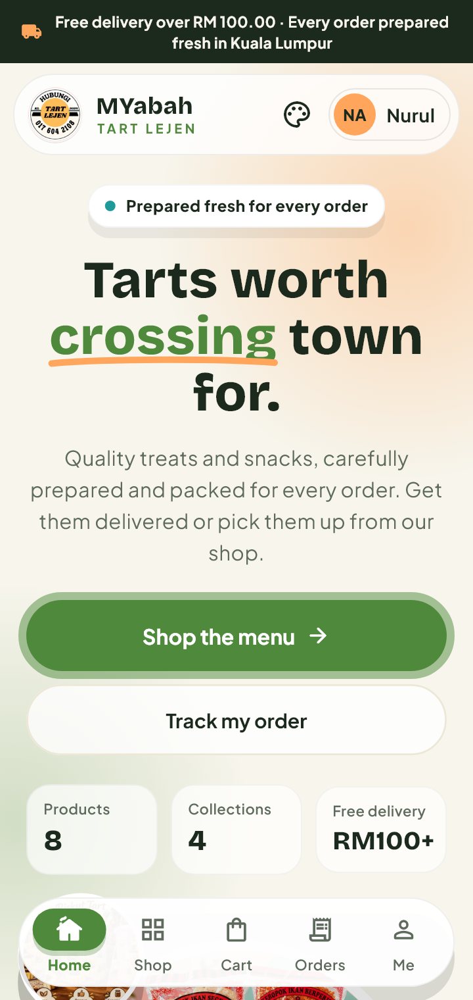<br><b>Home</b></td>
    <td align="center">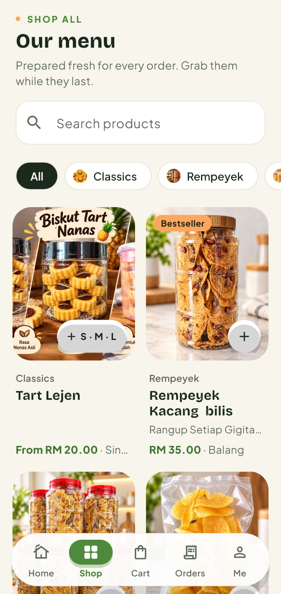<br><b>Menu</b></td>
    <td align="center">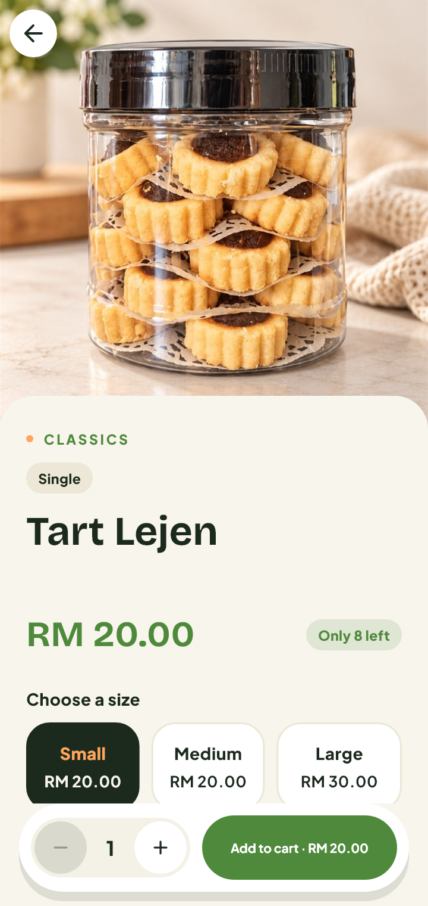<br><b>Product</b></td>
  </tr>
  <tr>
    <td align="center">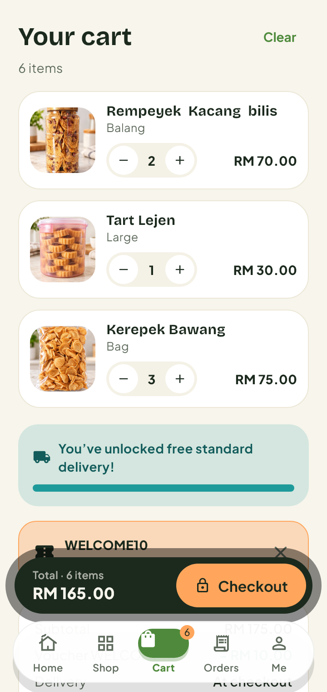<br><b>Cart</b></td>
    <td align="center">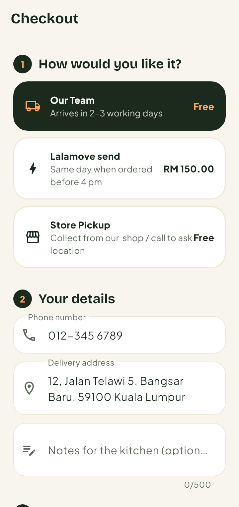<br><b>Checkout</b></td>
    <td align="center">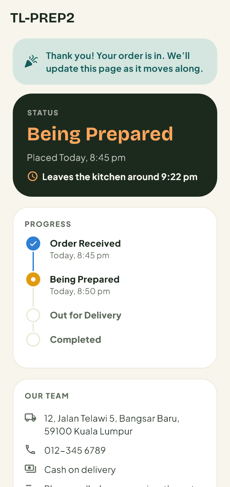<br><b>Order tracking</b></td>
  </tr>
  <tr>
    <td align="center">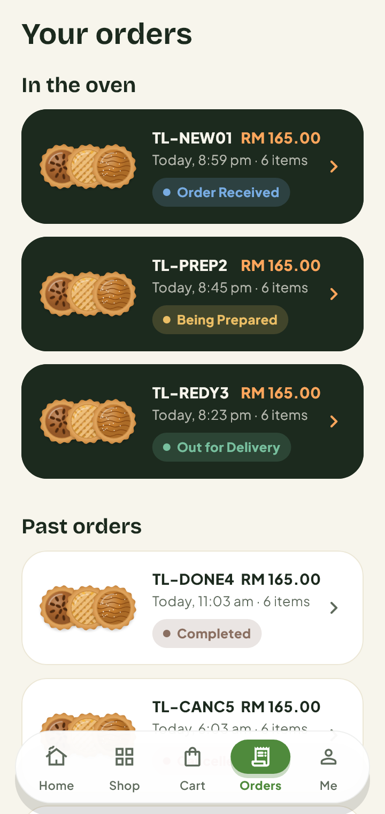<br><b>Your orders</b></td>
    <td align="center">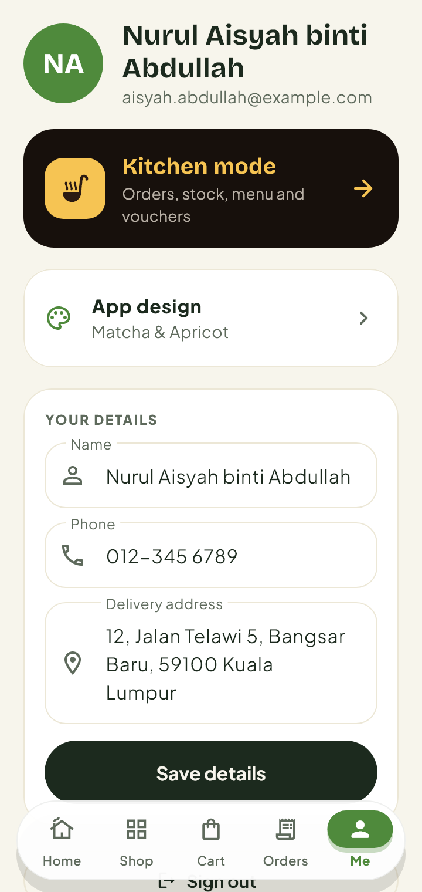<br><b>Profile</b></td>
    <td align="center">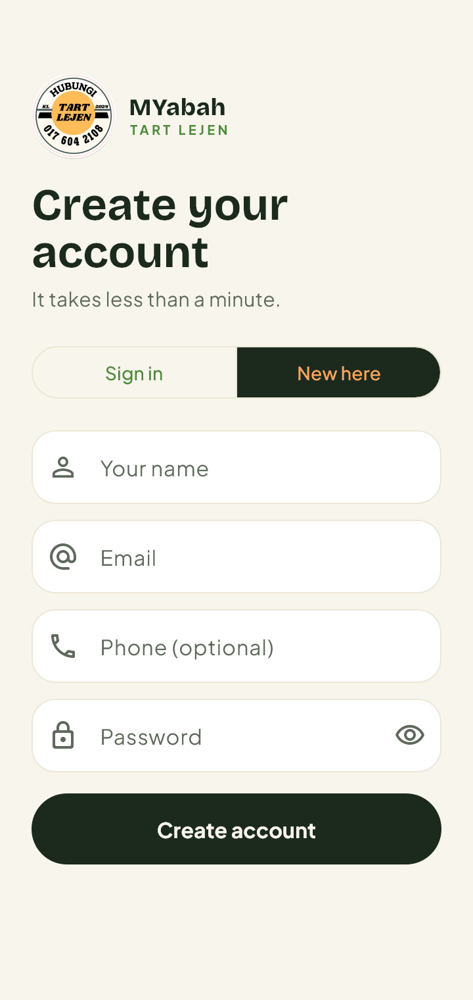<br><b>Sign up</b></td>
  </tr>
</table>

- **Menu:** search, collections, S/M/L sizes and live stock counts
- **Checkout:** vouchers, plus delivery by the shop's team, Lalamove or store pickup
- **Payment:** cash on delivery or pay at pickup
- **After ordering:** status tracking, cancellations, refund requests and product reviews

## Kitchen mode

Staff accounts get a separate dark workspace for the day-to-day running of the shop.

<table>
  <tr>
    <td align="center">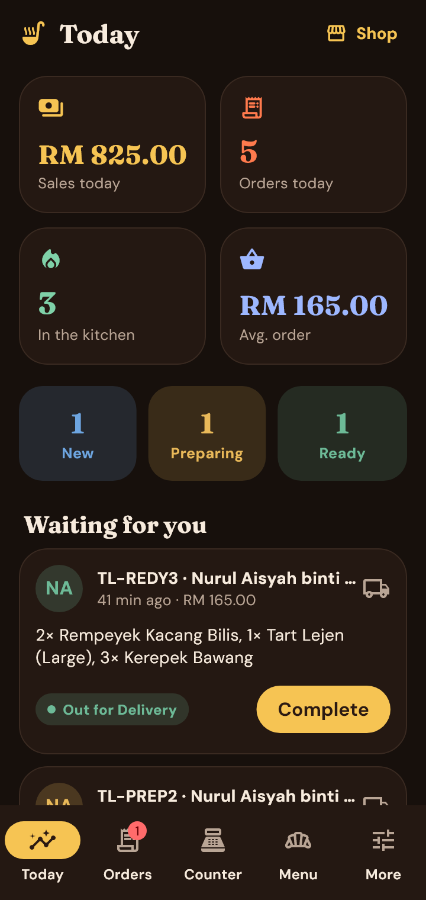<br><b>Today</b></td>
    <td align="center">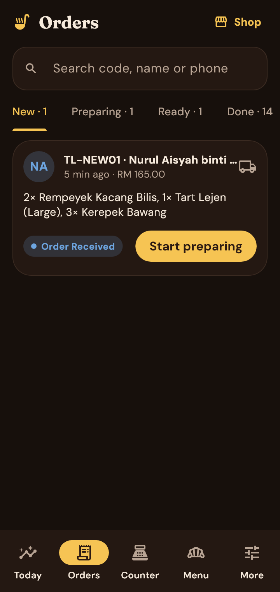<br><b>Orders</b></td>
    <td align="center">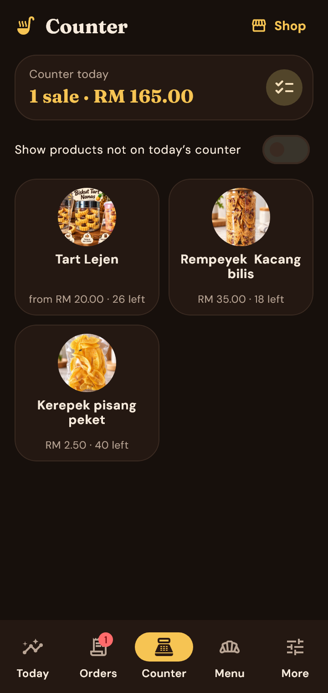<br><b>Counter</b></td>
  </tr>
  <tr>
    <td align="center">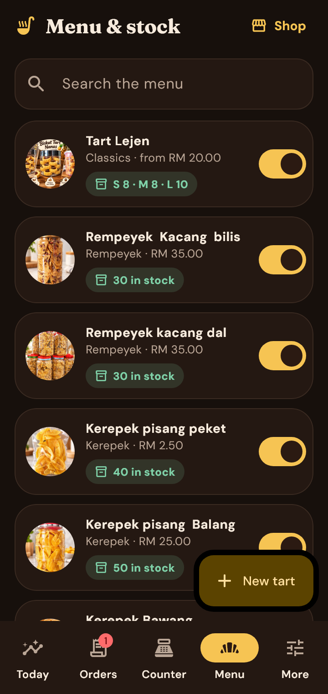<br><b>Menu &amp; stock</b></td>
    <td align="center">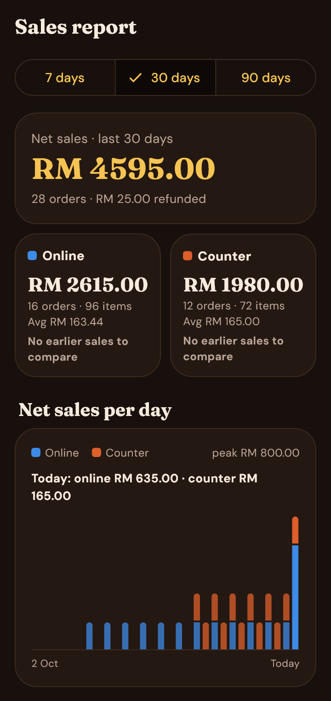<br><b>Sales report</b></td>
    <td align="center">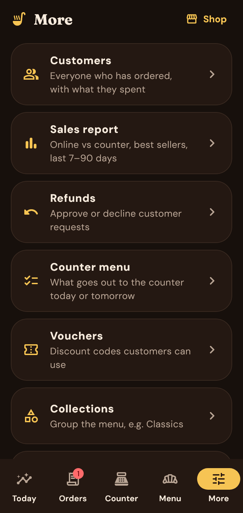<br><b>More tools</b></td>
  </tr>
</table>

- **Orders:** move orders through each status from a single queue
- **Counter:** take walk-in sales by cash, e-wallet/QR or card, and choose what goes on the counter menu
- **Reports:** online and counter sales over 7, 30 or 90 days, plus best sellers
- **Shop management:** products, stock, collections, vouchers, customers, refunds, delivery fees and home page text

## App designs

Customers can pick from eight designs, and the choice is saved on their device. Each one changes the colours, fonts and corner shapes.

<table>
  <tr>
    <td align="center"><br>Matcha &amp; Apricot</td>
    <td align="center">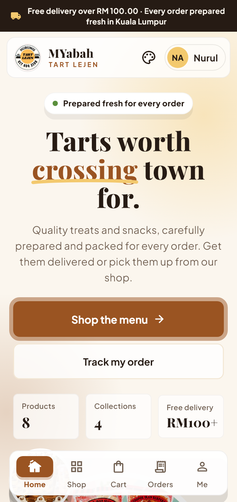<br>Caramel Classic</td>
    <td align="center">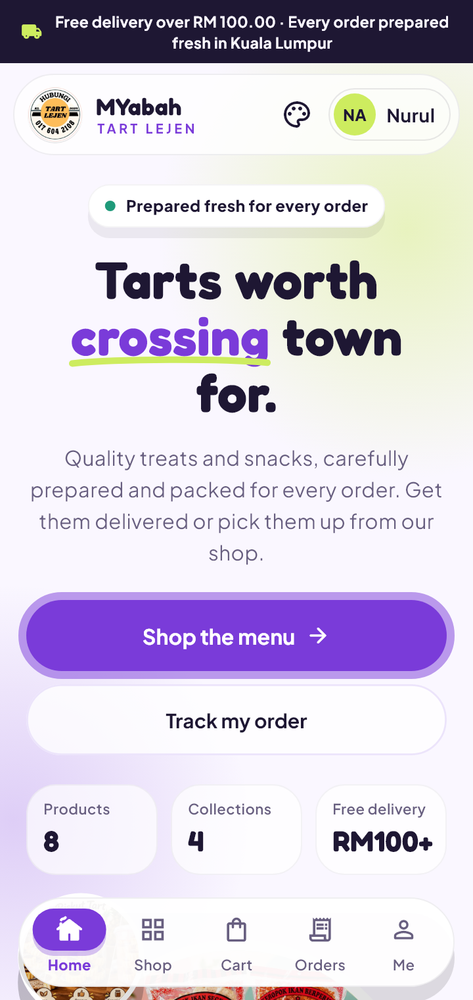<br>Lavender &amp; Lime</td>
    <td align="center">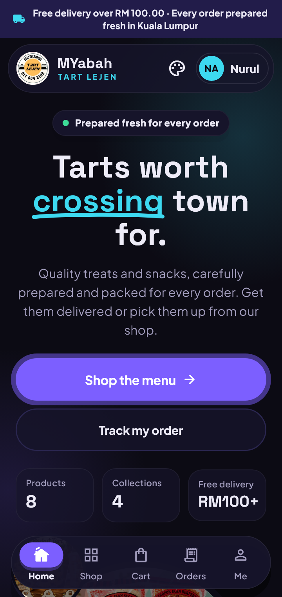<br>Midnight Neon</td>
  </tr>
</table>

The others are Raspberry & Butter, Blueberry & Coral, Mono Volt and Aurora Glow.

## Getting started

You need the [Flutter SDK](https://docs.flutter.dev/get-started/install) with Dart 3.13.7 or newer. To deploy database rules, you also need the [Firebase CLI](https://firebase.google.com/docs/cli).

```sh
flutter pub get
flutter run
```

To deploy the Firestore security rules:

```sh
firebase deploy --only firestore:rules
```

### Make someone staff

In the Firebase console, set `users/{uid}.role` to `admin`. **Kitchen mode** then appears on that person's profile screen.

### Not connected yet

Online payment (Billplz) and live Lalamove bookings aren't connected. Staff can store the keys under **More > Payments & delivery APIs**, but the app doesn't call either service. Their secret keys can't live in the customer app, so a server such as Firebase Cloud Functions has to make those calls.

## Tests and screenshots

```sh
flutter test                                    # run the tests in test/
flutter test test_preview --update-goldens      # regenerate the screenshots
```

Screenshots are saved to `test_preview/shots/`, so the images in this README update when you regenerate them.

## Project layout

```text
lib/
  models/     Products, orders, refunds and shop data
  screens/    shop/ (customers), admin/ (kitchen mode), auth/
  services/   Auth, cart, Firestore repository, sample data
  widgets/    Shared UI
  theme.dart  App designs and the kitchen theme
tool/         One-time import from the old website's database
test_preview/ Screenshot generator and output
```
